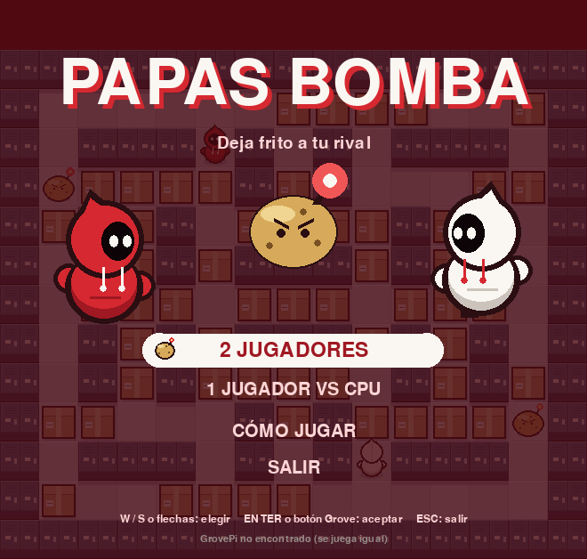
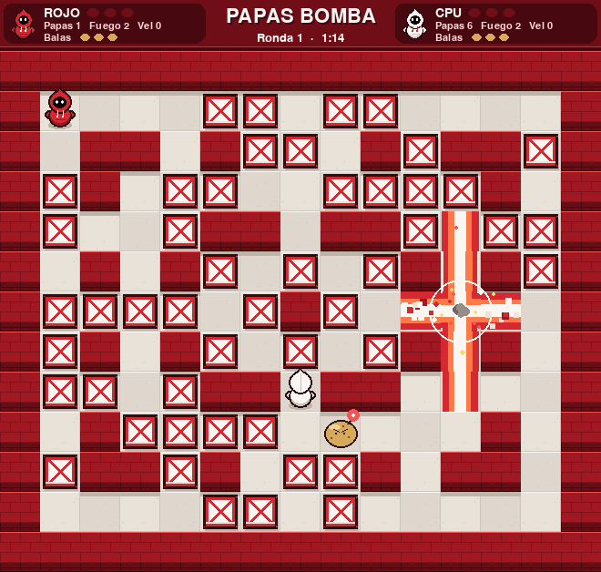
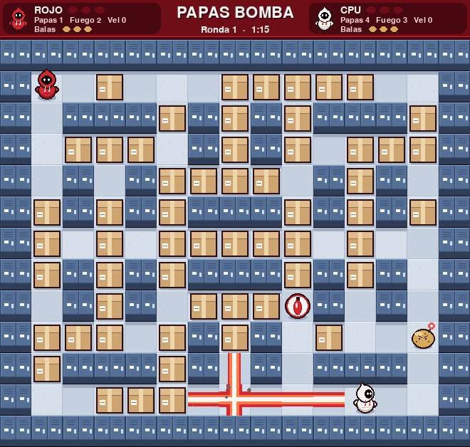
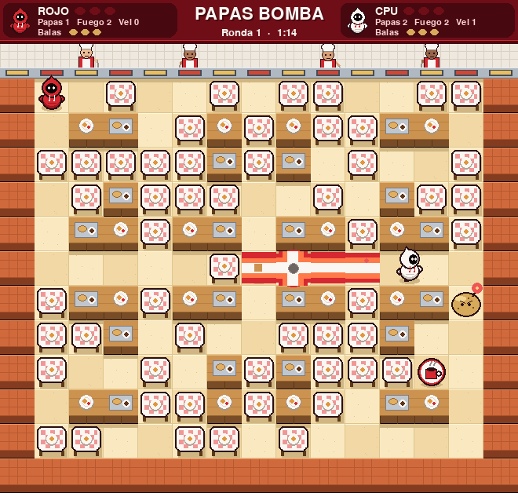

# Papas Bomba

Juego en Python + pygame para **Raspberry Pi 3** (con GrovePi+ opcional). Dos encapuchados, **ROJO** y **BLANCO**, se lanzan papas que explotan. El que quede frito pierde la ronda; gana el primero que llegue a 3.

Se juega de a 2 en el mismo teclado o 1 jugador contra la CPU.

| Menú | La Plazoleta |
|---|---|
|  |  |

| El Pasillo | La Cafetería |
|---|---|
|  |  |

## Cómo correrlo

Solo necesita Python 3 y pygame. En Raspberry Pi OS pygame ya viene instalado; si no:

```bash
sudo apt install python3-pygame
```

En un PC con Windows, Linux o Mac:

```bash
pip install pygame
```

Para jugar:

```bash
python3 papas_bomba.py
```

| Opción | Qué hace |
|---|---|
| `-f` | Pantalla completa (también con **F11** dentro del juego) |
| `--sin-sonido` | No usa el parlante (el buzzer del GrovePi sigue sonando) |

El juego es un solo archivo: no necesita imágenes ni audios. Todo se dibuja y se sintetiza por código.

## Controles

| | Moverse | Poner papa | Tirar papa | Disparar |
|---|---|---|---|---|
| **ROJO (J1)** | W A S D | E | F | Q |
| **BLANCO (J2)** | Flechas | CTRL derecho (o 0 numérico) | SHIFT derecho (o . numérico) | ENTER |

- **Menú:** W/S o flechas para elegir, ENTER (o el botón Grove) para aceptar, ESC para salir.
- **En partida:** P o ESC pausa. En pausa, ENTER o P sigue y ESC vuelve al menú.

## Reglas

- Las papas explotan en cruz a los 2,5 segundos y rompen las cajas (o las mesas, según la cancha).
- **Tirar:** la papa vuela 3 casillas por encima de todo. Parado sobre una papa, tuya o del rival, la recoges y la lanzas.
- **Cañón de papitas:** 3 balas que se recargan solas (1 cada 6 s). Una papita deja frito al rival, y si le pega a una papa bomba la hace explotar.
- **Muerte súbita:** a los 90 segundos la cancha se cierra desde los bordes y las balas no se acaban.
- **Poderes** que salen de las cajas: ají (más fuego), papa (más papas a la vez) y tinto (más rápido).

## Canchas

Rotan por ronda en orden al azar. Todas son simétricas para que ninguno salga con ventaja.

| Cancha | Ambiente |
|---|---|
| **La Plazoleta** | Ladrillo rojo, baldosa blanca y cajas de madera |
| **El Pasillo** | Casilleros azules y cajas de cartón |
| **La Cafetería** | Barras de madera, mesas con mantel en vez de cajas y cocineros sirviendo |

## GrovePi+ (opcional)

Si la tarjeta no está conectada, el juego funciona igual.

| Módulo | Puerto | Qué hace |
|---|---|---|
| Buzzer | D8 | Suena con cada explosión, disparo y cuenta regresiva |
| LED | D4 | Se prende cuando alguien queda frito |
| Botón | D3 | Acepta en los menús y pasa de ronda (como ENTER) |

## Qué hay en el repositorio

| Ruta | Contenido |
|---|---|
| `papas_bomba.py` | El juego, versión actual (v3) |
| `versiones/` | Las tres versiones completas del juego, cada una jugable por separado |
| `capturas/` | Capturas de pantalla |
| `docs/HISTORIAL_DE_VERSIONES.md` | Qué cambió en cada versión y por qué |
| `docs/REQUISITOS.md` | Requisitos funcionales y no funcionales |
| `docs/DISENO.md` | Arquitectura, máquina de estados y cómo decide la CPU |
| `docs/PRUEBAS.md` | Qué se probó, resultados y qué falta por probar |

Cada versión también está marcada con una etiqueta de Git: `v1.0`, `v2.0` y `v3.0`.

## Versiones

| Versión | Fecha | Resumen |
|---|---|---|
| **v1** | 7 nov 2026 | Mecánicas base para 2 jugadores y GrovePi |
| **v2** | 12 nov 2026 | Arte rojo y blanco con encapuchados, canchas propias, modo contra la CPU, menú, pausa y sonido |
| **v3** | 13 nov 2026 | Cada cancha con su propio color y ambiente; cafetería con mesas y cocineros |

El detalle está en [docs/HISTORIAL_DE_VERSIONES.md](docs/HISTORIAL_DE_VERSIONES.md).

## Herramientas

- Python 3 y pygame.
- Raspberry Pi 3 con GrovePi+.
- Git y GitHub para el control de versiones.
- Claude Code (asistente de IA de Anthropic) como apoyo en el desarrollo y las pruebas de las versiones 2 y 3.

## Autor

Juan David Ruiz — proyecto para la clase de Metodología de Desarrollo de Software.
