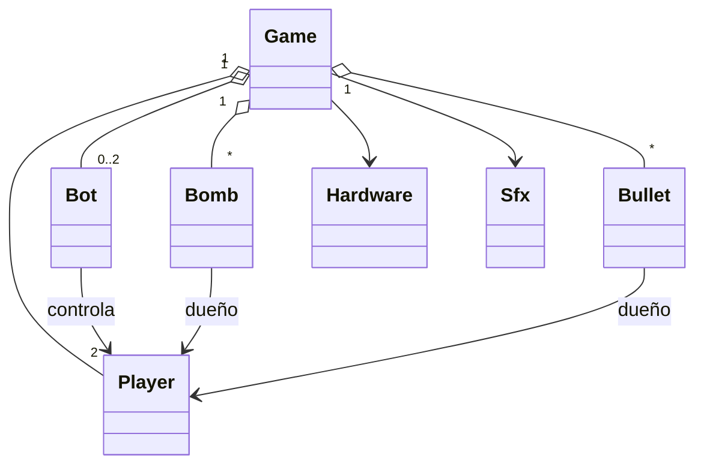
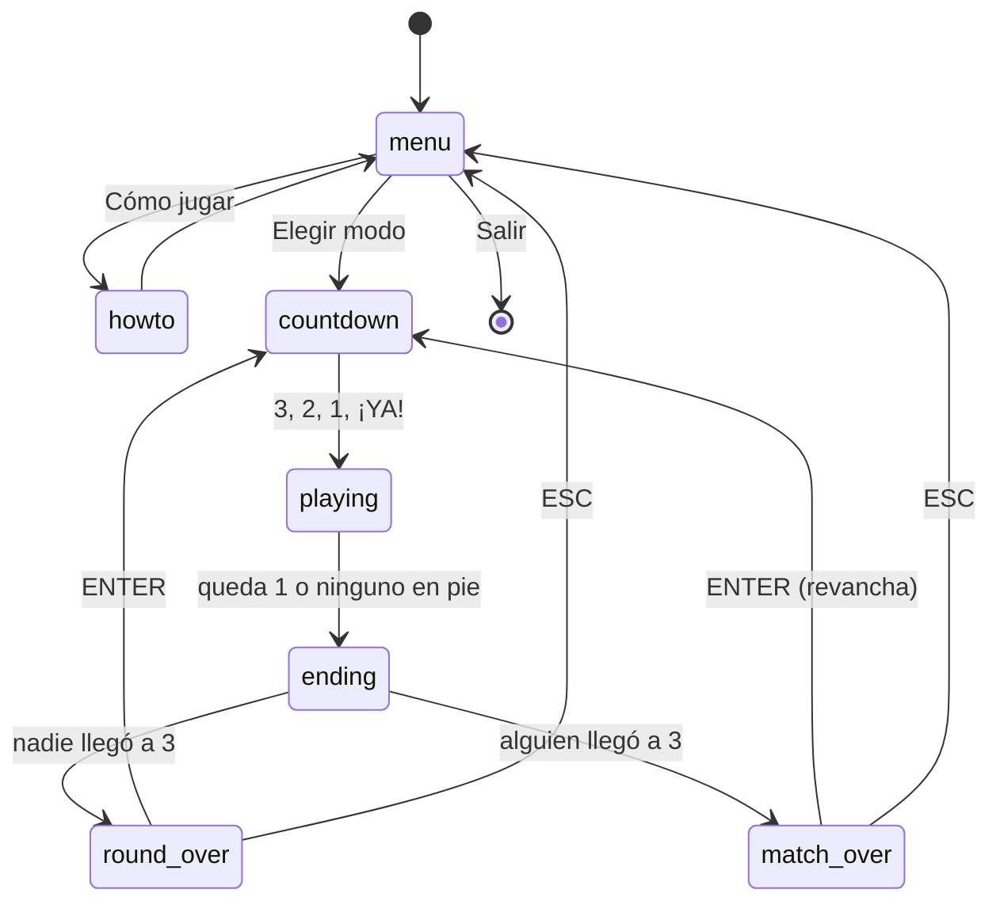

# Diseño

Describe la versión actual (v3), `papas_bomba.py`.

## Clases

Cada clase tiene una sola responsabilidad.

| Clase | Responsabilidad |
|---|---|
| `Game` | Reglas, estado de la partida y dibujo. Es la clase central. |
| `Player` | Datos de un jugador: posición, poderes, balas, teclas. |
| `Bomb` | Una papa bomba: dónde está, de quién es, cuánto le falta y si va volando. |
| `Bullet` | Una papita disparada por el cañón. |
| `Bot` | El cerebro de la CPU. Decide qué hace un `Player`. |
| `Hardware` | GrovePi+: buzzer, LED y botón, en un hilo aparte. |
| `Sfx` | Efectos de sonido sintetizados. |

`Hardware` y `Sfx` están aislados a propósito: si no hay GrovePi+ o no hay parlante, sus funciones simplemente no hacen nada y el resto del juego no se entera.

## Ciclo principal

En `main()`, 30 veces por segundo:

1. Leer el teclado y el botón Grove.
2. `game.update(dt)`: avanzar la lógica.
3. `game.draw()`: dibujar todo en un lienzo interno de 660×628.
4. `present()`: pasar el lienzo a la pantalla, escalándolo si hace falta.

## Máquina de estados

El atributo `Game.state` decide qué se actualiza y qué se dibuja.

La pausa no es un estado: es una bandera (`paused`) que congela cualquiera de los estados de partida.

En `menu` y `howto` el mundo sigue corriendo con dos CPU jugando entre sí. Es la demostración que se ve de fondo.

## El tablero

- La cancha es una cuadrícula de 15×13 casillas. Cada casilla es `EMPTY`, `WALL` o `BLOCK` (caja, caja de cartón o mesa).
- `LAYOUTS` define dónde van los muros de cada cancha.
- `THEMES` define cómo se ve cada cancha: colores, tipo de muro y tipo de objeto rompible.
- Las cajas y los poderes se reparten al azar, pero de a pares espejo, para que sea justo.

## Cómo explota una papa

1. `blast_cells(x, y, alcance)` calcula las casillas que alcanza: avanza en las cuatro direcciones y se detiene en un muro, o justo después de una caja, un poder u otra papa.
2. `explode(papa)` recorre esas casillas: rompe cajas, destruye poderes, marca las otras papas para que exploten ya y prende fuego.
3. En cada cuadro, el jugador que esté parado en una casilla con fuego queda frito.

`blast_cells` no modifica nada. Por eso la CPU también la usa para predecir el peligro.

## Cómo decide la CPU

Cada vez que llega a una casilla, `Bot.think()` sigue este orden:

1. **¿Estoy en peligro?** Arma un mapa de peligro (`danger_map`): para cada casilla, cuántos segundos faltan para que le llegue el fuego, teniendo en cuenta reacciones en cadena y los muros de la muerte súbita. Si su casilla está en ese mapa, busca con búsqueda en anchura (BFS) la casilla segura más cercana y corre hacia ella.
2. **¿Pongo o tiro una papa?** Pone una si alcanza al rival o a una caja, pero solo si después le queda ruta de escape (`can_escape`). Tira una si cae donde alcance al rival.
3. **¿Disparo?** Si tiene al rival en línea recta y sin obstáculos, dispara tras un retraso de reacción, para que el jugador alcance a quitarse.
4. **¿A dónde camino?** En este orden: un poder cercano, el rival si está a pocos pasos, una casilla junto a una caja, o el centro si hay muerte súbita.

## Rendimiento

| Técnica | Dónde |
|---|---|
| El escenario se pinta una vez en una capa fija y solo se repinta la casilla que cambia | `redraw_cell` |
| Los textos ya dibujados se guardan | `render` |
| Las capas transparentes se crean una sola vez | `shade` |
| Sombras de color sólido en vez de transparentes | `THEMES["shadow"]` |
| Tope de 240 partículas | `spark` |
| El GrovePi+ se atiende en otro hilo | `Hardware._loop` |

## Cómo ajustar el juego

Todo está al principio de `papas_bomba.py`.

| Qué | Constante |
|---|---|
| Tiempo de la mecha | `BOMB_TIME` |
| Rondas para ganar | `WINS_TO_MATCH` |
| Inicio de la muerte súbita | `ROUND_TIME` |
| Balas y recarga | `AMMO_MAX`, `AMMO_RECHARGE` |
| Cantidad de cajas y poderes | `CRATE_CHANCE`, `POWER_CHANCE` |
| Puertos del GrovePi+ | `BUZZER`, `LED`, `BOTON` |
| Canchas | `LAYOUTS` |
| Colores y ambiente de cada cancha | `THEMES` |
| Dificultad de la CPU | `Bot.hunt` y `Bot.react` |

Para una cancha nueva: 15 columnas × 13 filas, borde completo de `#`, simétrica al girarla 180°, y con las casillas (1,1), (2,1) y (1,2) libres, que es donde nace ROJO (BLANCO nace en el espejo). Hay que agregarle también su entrada en `THEMES`.
