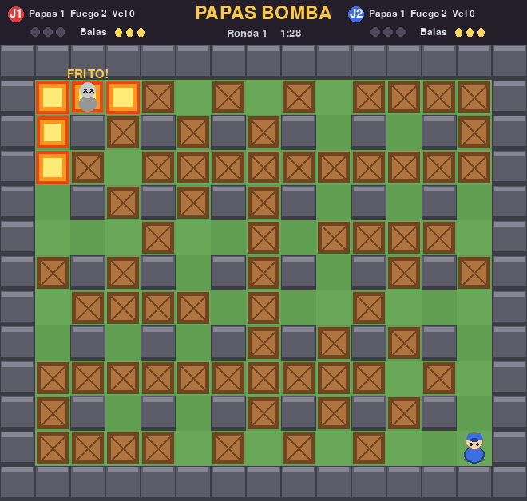
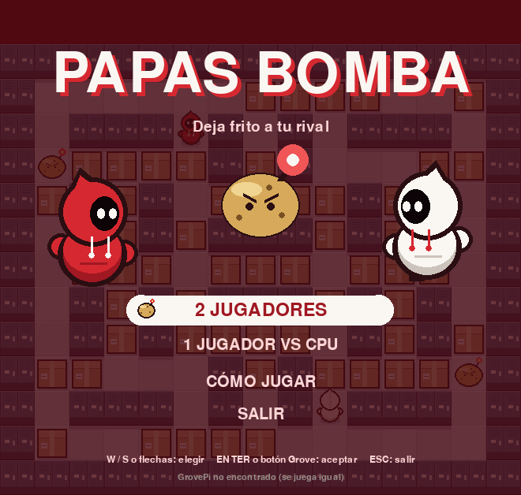
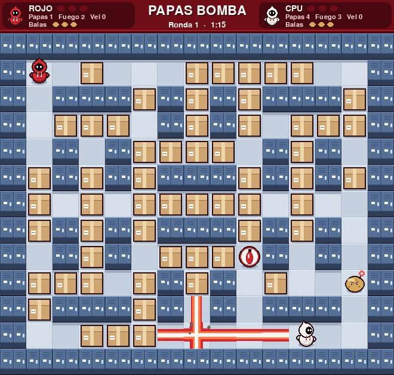
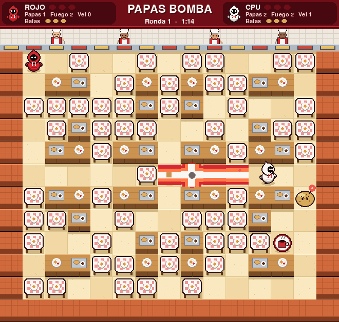

# Historial de versiones

El juego se desarrolló de forma **iterativa e incremental**: cada versión es un juego completo y jugable, y la siguiente se construyó sobre ella. Las tres están en la carpeta `versiones/` y marcadas con etiquetas de Git.

| Versión | Etiqueta | Archivo | Líneas de código |
|---|---|---|---|
| v1 | `v1.0` | `versiones/v1_papas_bomba.py` | 982 |
| v2 | `v2.0` | `versiones/v2_papas_bomba.py` | 1876 |
| v3 | `v3.0` | `versiones/v3_papas_bomba.py` (igual a `papas_bomba.py`) | 2066 |

Para correr una versión vieja:

```bash
python3 versiones/v1_papas_bomba.py
```

---

## v1 — Mecánicas base (7 nov 2026)



Primera versión jugable. Aquí se definieron las reglas que se mantienen hasta hoy.

- 2 jugadores en el mismo teclado (rojo y azul).
- Papas que explotan en cruz a los 2,5 s, con reacción en cadena.
- Tirar la papa 3 casillas, y recoger y lanzar la del rival.
- Cañón de papitas con 3 balas que se recargan.
- Muerte súbita a los 90 s: la cancha se cierra en espiral.
- Poderes: ají, papa extra y tinto.
- GrovePi+: buzzer, LED y botón, en un hilo aparte.
- Gana el primero en llegar a 3 rondas.

**Limitaciones que motivaron la v2:**

- Una sola cancha, con la cuadrícula de pilares típica del género.
- Solo se podía jugar de a dos.
- Una única pantalla de texto como menú; ESC cerraba el juego en plena ronda.
- Sin sonido por parlante.
- Con dos teclas apretadas siempre ganaba la misma dirección.

---

## v2 — Rojo y blanco, encapuchados y CPU (12 nov 2026)



Reescritura completa sobre las reglas de la v1.

### Cambios grandes

| Cambio | Antes (v1) | Ahora (v2) | Por qué |
|---|---|---|---|
| **Arte** | Pasto verde, muros grises, jugadores con gorra | Paleta roja y blanca, personajes encapuchados | Requisito del proyecto |
| **Canchas** | Una, con pilares cada dos casillas | Tres propias: La Plazoleta, El Pasillo y La Cafetería | La cuadrícula de pilares es el tablero característico de un juego comercial; con canchas propias el juego es original y cada ronda se juega distinto |
| **Modo de juego** | Solo 2 jugadores | 2 jugadores o 1 jugador contra la CPU | Poder mostrar el juego estando solo |
| **Pantallas** | Una pantalla de texto | Menú, cómo jugar, cuenta regresiva, pausa, fin de ronda y campeón | ESC ya no saca del juego por accidente |
| **Sonido** | Solo buzzer del GrovePi | Efectos por parlante, sintetizados por código | No depender del hardware para tener sonido |

### Detalles pulidos

- **Movimiento:** manda la última tecla apretada y, si por ahí hay pared, toma la otra.
- **Fuego:** una cruz continua que se adelgaza al apagarse, en vez de cuadros sueltos.
- **Efectos:** chispas, humo, astillas, onda expansiva, temblor de pantalla y textos flotantes.
- **Barra superior:** cara de cada jugador, rondas ganadas como papitas, balas con barra de recarga.
- **Botón Grove:** ya no hace nada en plena ronda, porque ENTER también es el disparo de BLANCO.
- **Demostración:** en el menú se ve de fondo una partida de CPU contra CPU.

### Rendimiento en la Raspberry Pi

- El piso, los muros y las cajas se pintan una sola vez en una capa fija; solo se repinta la casilla que cambia. En la v1 se redibujaban todas las cajas en cada cuadro.
- Los textos y las capas transparentes se guardan en memoria.
- Las sombras son de color sólido, sin transparencia.
- Las partículas tienen un tope de 240.

---

## v3 — Un ambiente por cancha (13 nov 2026)

| El Pasillo | La Cafetería |
|---|---|
|  |  |

En la v2 las tres canchas se veían iguales y solo cambiaba la distribución de los muros. En la v3 cada una tiene su propio color y ambiente. Los encapuchados, la barra superior y los menús siguen en rojo y blanco.

| Cancha | Piso | Muros | Lo que se rompe | Extra |
|---|---|---|---|---|
| **La Plazoleta** | Baldosa blanca | Ladrillo rojo | Cajas de madera | — |
| **El Pasillo** | Azul claro | Casilleros azules | Cajas de cartón | — |
| **La Cafetería** | Amarillo cálido | Barras de madera con platos y bandejas | Mesas con mantel de cuadros | Línea de servicio con cocineros |

- Las mesas y las cajas de cartón funcionan igual que las cajas: se rompen con las papas y pueden esconder poderes.
- Los cocineros sirven con el cucharón y se agachan cuando explota una papa. Son decoración: no afectan la partida.
- Los pedazos que saltan y las sombras toman los colores de cada cancha.
- En el código, el ambiente de cada cancha se define en la lista `THEMES`, separado de la distribución de muros (`LAYOUTS`), así que agregar una cancha nueva no obliga a tocar la lógica del juego.
